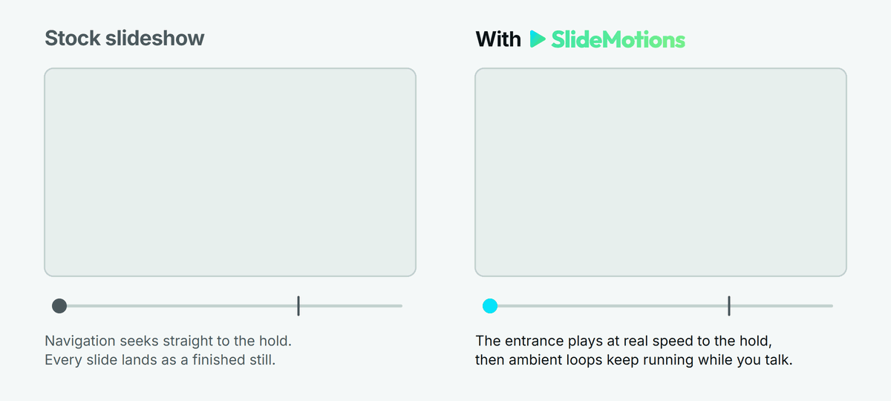
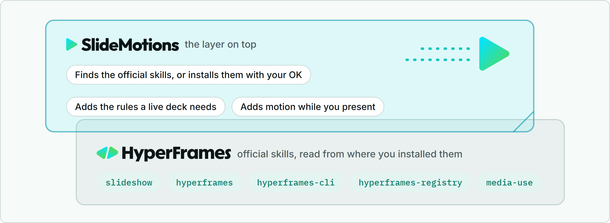

<h1 align="center">
<picture><source media="(prefers-color-scheme: dark)" srcset="assets/banner-dark.gif"></picture>
</h1>

<p align="center"><b>Ask your agent for a deck, then present a HyperFrames slideshow whose slides actually move: entrances play at real speed and ambient loops keep running while you talk.</b></p>

<p align="center">
<a href="#what-it-does"><picture><source media="(prefers-color-scheme: dark)" srcset="assets/btn-does-dark.webp"></picture></a>
<a href="#how-it-works"><picture><source media="(prefers-color-scheme: dark)" srcset="assets/btn-how-dark.webp"></picture></a>
<a href="#install"><picture><source media="(prefers-color-scheme: dark)" srcset="assets/btn-install-dark.webp"></picture></a>
<a href="#use"><picture><source media="(prefers-color-scheme: dark)" srcset="assets/btn-use-dark.webp"></picture></a>
</p>

## <picture><source media="(prefers-color-scheme: dark)" srcset="assets/ic-does-dark.webp"></picture> What it does

<picture><source media="(prefers-color-scheme: dark)" srcset="assets/fig-motion-dark.gif"></picture>

A stock HyperFrames slideshow moves between slides by seeking, so every slide appears already finished. SlideMotions makes the presented deck play: entrances run at their authored speed up to each hold, and ambient loops (flowing lines, sweeps, pings) keep going while a slide is on screen. Stills, `check` and snapshots still see the clean, seek-only composition.

Everything the HyperFrames slideshow gives you comes along:

- slides with fragment reveals and branching hotspots
- presenter mode with speaker notes, served by `hyperframes present`
- turning an existing page into a deck, keeping its look, motion and media

And it runs the project around the deck:

- from an idea: a content file with the table of contents, the script and sourced figures, approved before anything is built
- one folder per content file, so a second version of a topic never overwrites the first
- one shared toolchain, a `.gitignore`, and a README that lists every deck with the command that serves it

## <picture><source media="(prefers-color-scheme: dark)" srcset="assets/ic-how-dark.webp"></picture> How it works

<picture><source media="(prefers-color-scheme: dark)" srcset="assets/fig-layers-dark.webp"></picture>

SlideMotions is a thin layer over the official HyperFrames skills by HeyGen, not a fork. It ships no copy of their guidance: on every run it finds the skills you installed and reads them there, so you always build with the version you have. Missing skills are installed only after you approve the command and choose project or global scope. The layer rules are tested against HyperFrames `v0.9.41`.

## <picture><source media="(prefers-color-scheme: dark)" srcset="assets/ic-install-dark.webp"></picture> Install

```sh
npx skills add the-khiem7/slide-motions
```

You also need Node.js 22+ and npm for the HyperFrames CLI. The official HyperFrames skills are set up on first use, with your approval, or you can install them ahead of time:

```sh
# Claude Code, as a plugin
claude plugin marketplace add heygen-com/hyperframes
claude plugin install hyperframes@hyperframes

# any agent, standalone and global
npx hyperframes skills update
npx hyperframes skills update slideshow
```

Other clients (Copilot CLI, VS Code, Cursor, Gemini CLI, Codex, OpenCode, IBM Bob, Antigravity) have their own route; the skill picks the right one for the agent it runs in.

## <picture><source media="(prefers-color-scheme: dark)" srcset="assets/ic-use-dark.webp"></picture> Use

Type `/slide-motions` and describe the deck, or point it at a page to turn into one. The agent builds the slideshow, checks it until it is clean, and serves it:

```sh
npx hyperframes check --json
npx hyperframes present <project-dir>
```

Open the URL it prints, then click Present, or press P, to open the audience tab. Sharing in Google Meet: share the audience tab. In Zoom: drag the audience tab into its own window and share that window.

## <picture><source media="(prefers-color-scheme: dark)" srcset="assets/ic-wont-dark.webp"></picture> What it will not do

- Render a deck to MP4. `render` keeps only the first scene; stills come from `snapshot` instead.
- Install anything without asking you first.
- Carry or rewrite HeyGen's guidance. It reads the official skills where you installed them.
- Report its work under the official skill's name through the HyperFrames usage beacon.

## Reference

<details>
<summary>Repository layout</summary>

| Path | Content |
|---|---|
| `slide-motions/SKILL.md` | The skill: finding the official skills, detecting the stage, then the rules for slides, the root clock, the runtime include, fragments, hotspots and hand-off |
| `slide-motions/references/live-motion.md` | Entrances that play at real speed and ambient loops in the presented deck, with code |
| `slide-motions/references/resolve-upstream.md` | Finding the official skills: client, search locations, mode |
| `slide-motions/references/install-upstream.md` | Installing the official skills per client and scope, asked before running |
| `slide-motions/references/project-workflow.md` | The project around a deck: stage, intake questions, content file, folder layout, toolchain, `.gitignore`, README |
| `AGENTS.md` | Rules for an agent that improves this skill |
| `assets/` | README images; their HTML sources are in `assets/source/` |

</details>

### Licence

Apache-2.0 for this repository's own work (`LICENSE`). `slide-motions/SKILL.md` is derived from the official HyperFrames `slideshow` skill. HyperFrames and its logo belong to HeyGen; the logo appears here only to credit the project this skill builds on.
